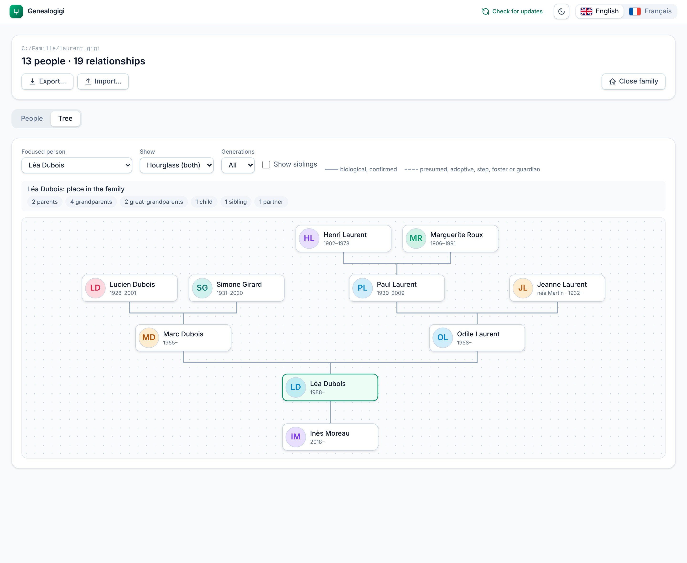

<p align="center">
  
</p>

<h1 align="center">Genealogigi</h1>

<p align="center">
  <strong>Your family's story. Your data.</strong><br />
  A local-first desktop app for building and exploring one family's genealogy.
</p>

<p align="center">
  <a href="https://github.com/promethee/genealogigi/actions/workflows/ci.yml"></a>
  <a href="./LICENSE"></a>
  
  
</p>

<p align="center">
  <a href="https://github.com/promethee/genealogigi/releases/latest"><strong>Download</strong></a> ·
  <a href="https://promethee.github.io/genealogigi/">Project page</a> ·
  <a href="./DEVELOPMENT.md">Development guide</a> ·
  <a href="./DECISIONS.md">Design decisions</a>
</p>

<picture>
  <source media="(prefers-color-scheme: dark)" srcset="docs/screenshots/tree-dark.jpg" />
  
</picture>

## Overview

Genealogigi records a single family's ancestry and renders it as navigable trees. It is built for
people who have never used genealogy software: forms use plain words, dates may be partial, and
every destructive action asks first.

The design goal is **data ownership**. A family is one plain-JSON file (`.gigi`) on the user's
disk. There is no account, no cloud and no telemetry; the only network request the app ever makes
is a read-only check of the public GitHub releases API, and it sends no family data.

## Features

| Area | What it does |
| --- | --- |
| **People** | Several names per person (birth, married, nickname) with dates; partial birth/death dates; birth and death places; living/deceased status; free-text notes; portrait photos. |
| **Relationships** | Parent-child links (biological confirmed/presumed, adoptive, step, foster, guardian, with status and dates) and partnerships. Duplicate links and cycles are rejected. |
| **Trees** | Ancestors, descendants and hourglass layouts, with siblings; scaled to the window; a focused person with generation counts; soft, cumulative filters (status, places, months, last name) that fade rather than hide. |
| **Person card** | Derived timeline (births, name changes, partnerships, children, user events), immediate-family mini tree, photo gallery. |
| **Search** | Accent- and case-insensitive over names, places and notes; filters the list, highlights in the tree. |
| **Sharing** | Export one self-contained, read-only HTML page that opens offline in any browser, plus export/import of the family file. Import replaces the family only after a confirmation and a verified, hashed backup. |
| **Experience** | English and French, light and dark themes, in-app confirmations, update notification (never auto-installs). |

## Architecture

```
┌──────────────────────────── Vue 3 UI (views, components) ───────────────────────────┐
│                         Pinia stores (family, app, theme, language)                 │
├─────────────────────────────────────────────────────────────────────────────────────┤
│  PlatformAPI  ── the only seam to the shell (files, dialogs, settings, window, exit) │
├───────────────────────────────┬─────────────────────────────────────────────────────┤
│  Tauri 2 implementation       │  src/data: framework-free TypeScript domain logic    │
│  (Rust commands, plugins)     │  (model, pedigree layout, timeline, search, import)  │
└───────────────────────────────┴─────────────────────────────────────────────────────┘
```

- **Shell portability.** Window, file-dialog and storage calls go through one `PlatformAPI`
  interface; components and stores never call Tauri directly. The Tauri shell is a thin, swappable
  wrapper.
- **Pure domain layer.** Data operations are plain functions `(FamilyData, input) => FamilyData`.
  The store applies a change, saves it through a serial queue, and only then updates memory, so a
  failed save leaves the app exactly as it was.
- **Derived, never duplicated.** Siblings, timelines, trees and the shared web page are computed
  from the stored people, relationships and events; nothing is stored twice.
- **Spec-driven.** Every feature starts as an [OpenSpec](./openspec) change (proposal, spec,
  design with recorded decisions, tasks) and is archived when shipped.

## Data format

A `.gigi` file is plain JSON with a schema version, so it stays readable without the app and can
be migrated:

```jsonc
{
  "schemaVersion": 1,
  "people": [ /* names, born, lifeStatus, notes, photos */ ],
  "relationships": [ /* parent-child (nature, status, dates) and partnerships */ ],
  "events": [ /* marriage, residence, ... linked to one or more people */ ]
}
```

Photos are embedded as downscaled JPEG data URLs (max 480 px), so a family is a single portable
file. Writes are atomic (temp file then rename). Imports are validated structurally: malformed
files and newer schema versions are refused, damaged items are dropped and reported.

## Quality

- **Unit tests (Vitest)** for the data layer, i18n catalog parity, version consistency and WCAG
  contrast of both themes.
- **End-to-end tests (Playwright)**: the real UI and store against a fake `PlatformAPI`, one spec
  per feature.
- **Rust tests** for the native commands.
- **CI on Windows**: format, lint, type-check, unit, build, e2e and Rust checks on every push.
- **Real-app tests** drive the actual Tauri window (real files, settings, restarts, image decoding,
  update check, OS theme and language) on Linux under a virtual display: `npm run test:real`.
- What a machine cannot judge (native OS dialogs, the window icon, how it looks) is a short
  22-row checklist in [MANUAL_TESTS.md](./MANUAL_TESTS.md).

## Getting started

Download the installer from the [latest release](https://github.com/promethee/genealogigi/releases/latest),
or build from source (Node.js 24+, Rust stable with the MSVC toolchain, see the
[Tauri prerequisites](https://tauri.app/start/prerequisites/)):

```sh
npm install
npm run tauri:dev     # desktop app with hot reload
npm run tauri:build   # installer in src-tauri/target/release/bundle
```

Full setup, test commands and project layout: [DEVELOPMENT.md](./DEVELOPMENT.md).

## Stack

Tauri 2 · Vue 3 (`<script setup>`) · Pinia · Tailwind CSS 4 · TypeScript · JSON file storage.
Rationale for each choice: [DECISIONS.md](./DECISIONS.md).

## Roadmap

Planned for v2: automatic backups with restore, a family statistics dashboard, git-based sync
(the engine exists, the UI is parked), and signed installers with in-app updates. Details in
[TODO.md](./TODO.md).

## Built with AI

Genealogigi is developed with [Claude Code](https://claude.com/claude-code), Anthropic's coding
agent. The split of work is deliberate:

- **Human-designed data model.** I designed the initial data structures (people, names, partial
  dates, relationships, life status) by hand. They are the foundation the rest is built on, and
  they are still the part I keep the tightest control of.
- **Iterative design decisions.** From there, each feature is a short conversation: I describe the
  need or react to what I see, the agent proposes a design with its trade-offs, and the decision is
  recorded with its reasoning (`design.md` in each [OpenSpec](./openspec) change, summarised in
  [DECISIONS.md](./DECISIONS.md)) before any code is written.
- **Agent implementation, checked by tests.** The agent implements exactly what the change
  specifies, adds a scoped end-to-end test per feature, and must pass format, lint, type-check,
  unit, build and e2e checks before anything is committed.
- **Human review.** I review the running UI, push back on wording and layout, and own the final
  manual checks ([MANUAL_TESTS.md](./MANUAL_TESTS.md)) that automation cannot cover.

The specs, decisions log and test suite are in the repository, so every choice can be traced and
challenged.

## License

MIT, see [LICENSE](./LICENSE).
